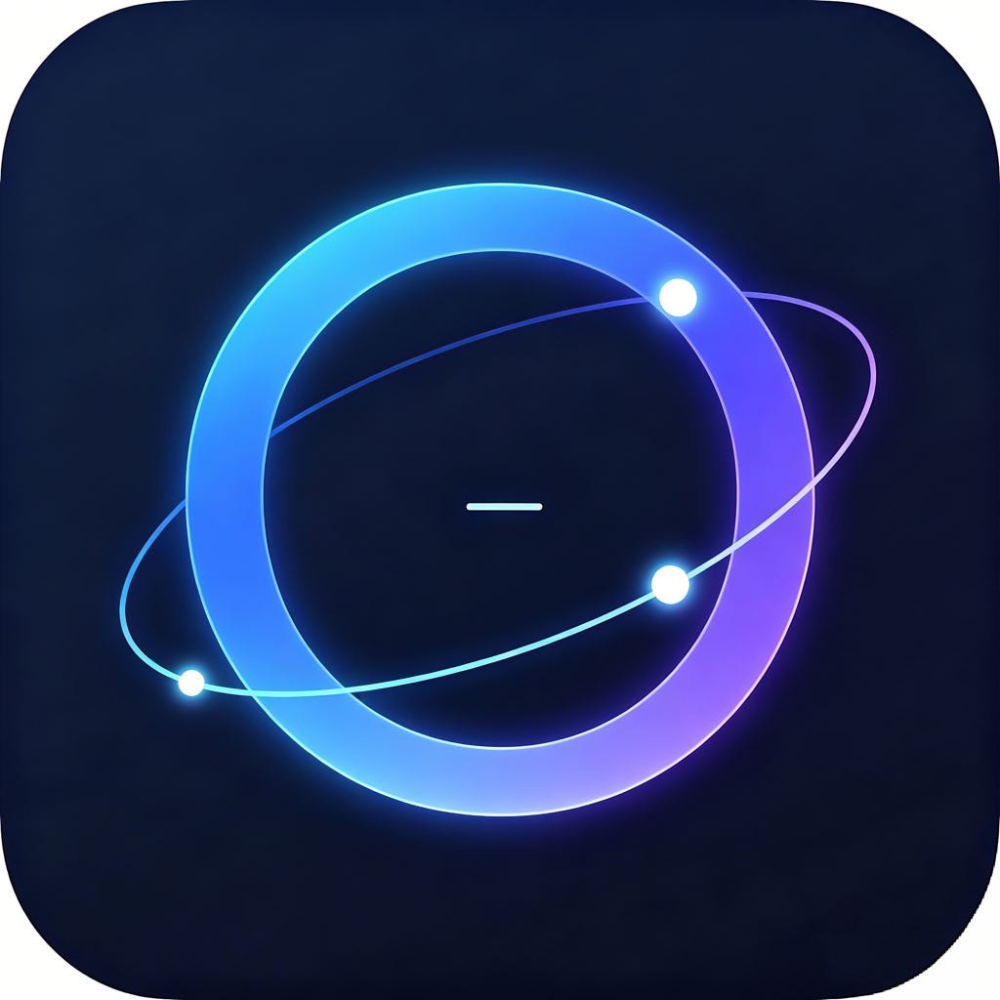

<div align="center">



# Orbit

原生 macOS SSH 工作台，面向开发者与运维人员。

[](https://github.com/ibreez3/orbit/releases)
[](LICENSE)
[](#环境要求)
[](#从源码构建)

[English](README.md)

</div>

---

Orbit 把日常管理 Linux 服务器所需的工具集中到一个原生 macOS 应用里：SSH 终端、SFTP、远程编辑、资源监控、Docker、数据库、批量执行和 AI 辅助运维。界面基于 SwiftUI 与 AppKit，SSH、SFTP、存储和 AI Agent 网关由 Rust 核心实现，并以静态库方式链接进 App。

Orbit 面向每天需要操作多台服务器的开发者与运维人员：与其在终端、文件浏览器、监控面板和聊天窗口之间来回切换，不如把工作集中在一个专注的桌面应用里。

## 核心亮点

- **原生实现，不是 Electron** —— SwiftUI/AppKit 界面 + Rust 核心，面向 Apple Silicon 打包。
- **一个工作台覆盖日常运维** —— 终端标签页与分屏、SFTP、资源监控、Docker、数据库查询、批量执行、命令片段、跳板机和端口转发。
- **AI 能力可控** —— 内置兼容 OpenAI 接口的 AI 助手；可选开启 MCP/CLI 网关，让本机 AI Agent 经过 Orbit 的授权与审计层执行命令。
- **凭据留在本地** —— 密码和私钥使用 AES-256-GCM 加密，不会交给 AI Agent。

## 功能特性

### 终端与工作区

- 基于 SwiftTerm 的 `xterm-256color` 终端，支持标签页、分屏、尺寸同步和高吞吐输出。
- 除远程 SSH 会话外，也支持本地终端会话。
- `⌘⇧P` 命令面板，`⌘K` 快速连接。
- 可自定义快捷键、内置多套主题，并支持终端关键词高亮。

### 远程文件与编辑

- SFTP 文件管理：浏览、上传、下载、重命名、删除、拖拽上传和传输进度。
- 远程文本编辑：打开常见文本、配置和代码文件，修改后通过 SFTP 保存回服务器。

### 监控与运维

- 资源监控：CPU、内存、磁盘、网络、进程列表和 Swift Charts 趋势图。
- Docker 管理：容器列表、状态、单容器 CPU/内存、日志，以及启动、停止、重启和删除。
- 批量执行：跨多台服务器并发执行命令，支持超时、取消和逐台结果状态。
- 命令片段：模板支持 `{{host}}`、`{{user}}`、`{{port}}`、`{{server_name}}` 和 `{{group}}` 变量。
- 跳板机支持：通过堡垒机连接目标服务器，自动建立本地 TCP 转发。
- 端口转发：在设置中管理本地到远端的 SSH 隧道规则。

### 数据库

- 支持远程 SQLite（通过 SSH）、MySQL 和 PostgreSQL。
- SQL 编辑器支持只读模式、查询超时、自动 `LIMIT`、结果表格和表结构浏览。
- 支持备份，以及带列映射的常见数据格式导入。

### AI 助手

- 内置 AI 面板，可接入任意兼容 OpenAI 的接口，包括 OpenAI、DeepSeek、Qwen、Kimi 和 Ollama。
- AI 可以在 ```` ```execute ```` 代码块中给出命令建议；Orbit 会在执行前请求确认。
- AI 活动会写入审计日志，并显示在设置中。

### AI Agent 网关（MCP + CLI）

Orbit 可以把指定服务器开放给本机 AI Agent，例如 Claude Code、Codex，或任何具备 shell 能力的 Agent。Agent 不会拿到 SSH 凭据，所有命令都要经过 Orbit 的接入、授权和审计层。

- **MCP bridge** —— `orbit-mcp` 提供服务器列表、读写执行、长任务、持久 shell 和授权状态等工具。
- **CLI** —— `orbit-cli` 提供 `auth`、`servers`、`exec`、`job` 和 `shell` 子命令，供不支持 MCP 的 Agent 使用。
- **仅本机访问** —— 网关只监听 Unix socket（`agent.sock`，权限 `0600`），不开放 TCP 端口。
- **授权与审计** —— 新会话需要用户批准；服务器逐台开放；写操作需要会话级授权；会话可随时撤销；调用记录写入 `~/Library/Application Support/Orbit/agent/audit.log`。

完整接入方式与安全模型见 [docs/agent-mcp-setup.md](docs/agent-mcp-setup.md)。

## 截图

仓库暂未提交截图。欢迎贡献能展示主要工作流的截图或简短演示 GIF。

## 环境要求

使用应用：

- macOS 13.0 或更高版本
- Apple Silicon Mac（主要支持目标）
- 资源监控与 Docker 功能面向 Linux 服务器

开发环境：

- macOS 13.0 或更高版本
- Xcode 15 或更高版本
- Rust 1.77 或更高版本，并安装 `aarch64-apple-darwin` target
- XcodeGen（`brew install xcodegen`）

## 安装

前往 [GitHub Releases](https://github.com/ibreez3/orbit/releases) 下载最新版本。

| 文件 | 说明 |
| --- | --- |
| `Orbit-v*-AppleSilicon.dmg` | 推荐的 Apple Silicon 安装包 |
| `Orbit*.zip` | 可用时提供的压缩包 |

发布版本使用临时签名（ad-hoc），暂未 Apple 公证。首次打开时，请右键点击 `Orbit.app`，选择「打开」，然后确认。也可以在终端执行：

```bash
xattr -cr /Applications/Orbit.app
```

## AI Agent 接入

先打开 **设置 → AI Agent → 允许 MCP / CLI Agent 接入 Orbit**，再按服务器逐台开放。首次连接需要在 Orbit 中批准。

Claude Code：

```bash
claude mcp add orbit -- /Applications/Orbit.app/Contents/MacOS/orbit-mcp
```

Codex（`~/.codex/config.toml`）：

```toml
[mcp_servers.orbit]
command = "/Applications/Orbit.app/Contents/MacOS/orbit-mcp"
```

不支持 MCP 的 Agent 可以直接使用 CLI：

```bash
/Applications/Orbit.app/Contents/MacOS/orbit-cli auth --client "My Agent"
/Applications/Orbit.app/Contents/MacOS/orbit-cli servers
/Applications/Orbit.app/Contents/MacOS/orbit-cli exec --server "prod-1" --mode read -- "docker ps"
```

需要修改状态时使用 `--mode write`。对某台服务器的第一次写操作会弹出一次授权面板，同一会话内的后续写操作复用该授权。长命令会返回 `jobId`，可用 `orbit-cli job status|output|cancel` 轮询或取消。

## 从源码构建

```bash
git clone https://github.com/ibreez3/orbit.git
cd orbit

# 构建 Rust arm64 静态库
./scripts/build-rust.sh

# 生成 Xcode 工程、构建 Release，并验证签名和关键权限
make build-app

# 打开 Xcode 工程进行开发
open orbit-app/Orbit.xcodeproj
```

常用命令：

```bash
cd orbit-app && xcodegen generate && cd ..
cd orbit-app && xcodebuild -project Orbit.xcodeproj -scheme Orbit -configuration Release -arch arm64 build
cargo test --manifest-path orbit-rs/Cargo.toml --release --target aarch64-apple-darwin
```

## 项目结构

```text
orbit/
├── orbit-app/                 # SwiftUI/AppKit macOS 应用
│   ├── project.yml            # XcodeGen 工程配置源码
│   ├── AgentKit/              # Agent 网关协议、MCP/CLI 支持
│   ├── OrbitCLI/              # orbit-cli 入口
│   ├── OrbitMCP/              # orbit-mcp 入口
│   └── Orbit/
│       ├── OrbitApp.swift     # 应用入口
│       ├── OrbitBridge.swift  # Swift/C FFI 桥接层
│       ├── Agent/             # 网关服务与授权 UI
│       ├── Models/            # 数据模型和服务
│       ├── ViewModels/        # 拆分后的 ObservableObject 状态
│       └── Views/             # UI 视图
├── orbit-rs/                  # Rust 核心，编译为静态库
│   ├── src/ffi.rs             # C ABI 导出函数
│   ├── src/ssh.rs             # SSH 会话和终端 channel 管理
│   ├── src/sftp.rs            # SFTP 操作
│   ├── src/transport.rs       # 直连和跳板机传输层
│   ├── src/database/          # 数据库查询、备份和导入
│   ├── src/db.rs              # SQLite 存储
│   └── include/orbit.h        # 生成的 C 头文件
├── scripts/                   # 构建和验证脚本
└── docs/                      # appcast、Agent 接入和设计文档
```

## 安全说明

- 凭据使用 AES-256-GCM 本地加密。
- 当前加密密钥绑定本机 hostname；将数据库迁移到其他 Mac 后需要重新输入凭据。
- AI Agent 网关只监听本机 Unix socket，每个新 Agent 会话都需要显式批准。
- 读命令不逐条确认；写命令需要绑定「Agent 会话 + 服务器」的授权。
- 命令守卫和授权流程是安全辅助层，不是沙箱：如果命令本身暴露了远端敏感信息，Agent 仍可能把它带进自己的上下文。
- 发布版本暂未 Apple 公证。
- 跳板机需要开启 `AllowTcpForwarding yes`。

## 已知限制

- 资源监控脚本面向 Linux 服务器，不适用于 macOS/BSD 主机。
- 当前主要发布 Apple Silicon arm64 构建。
- 部分高级 SSH 能力取决于远端服务器配置。

## 贡献

欢迎提交 Issue 和 Pull Request。

1. Fork 本仓库。
2. 创建功能分支：`git checkout -b feature/my-feature`。
3. 保持改动聚焦，并以 `project.yml` 作为 Xcode 配置的唯一源码。
4. 运行相关构建和测试命令。
5. 向 `develop` 分支提交 Pull Request。

架构说明、FFI 规范、构建命令和开发约定请参考 [AGENTS.md](AGENTS.md)。

## 许可证

Orbit 使用 [MIT License](LICENSE) 开源。
